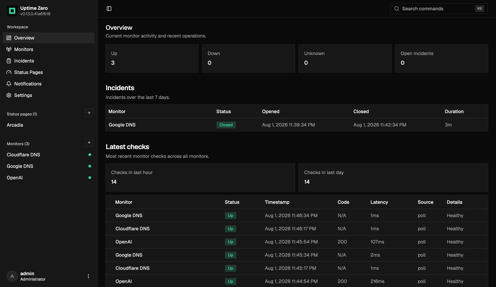

# Uptime Zero

**Simple self-hostable uptime monitoring, built to run on Cloudflare.**

Uptime Zero is heavily inspired by [Uptime Kuma](https://github.com/louislam/uptime-kuma) and [OpenStatus](https://github.com/openstatusHQ/openstatus), but built for people who want a simple monitor dashboard, public status pages, and webhook alerts without keeping a separate server around.

> [!WARNING]
> Uptime Zero is still early-stage software. Expect breaking changes, rough edges, and missing pieces while the project is actively taking shape.

## Live Demo

Try the hosted demo at [uptime-zero-demo.anyranges.workers.dev](https://uptime-zero-demo.anyranges.workers.dev/).

```txt
Email: admin@gmail.com
Password: AdminPass24!
```

## Preview



## ✨ Features

- HTTP and DNS uptime monitors
- Public status pages for sharing service health
- Incident history from monitor state changes
- Webhook alerts when monitors change state
- Configurable retention for monitor checks and incidents
- Cloudflare-native runtime with Workers, D1, and cron triggers, deployed with Void

## 🚀 Deploy

The full deployment guide is in [docs/deployment.md](docs/deployment.md). The code layout and its rules are in [docs/architecture.md](docs/architecture.md).

For the short version, install dependencies, set the auth secrets, and deploy with [Void](https://void.cloud):

```sh
pnpm install
pnpm void secret put BETTER_AUTH_SECRET
pnpm void secret put BETTER_AUTH_URL
pnpm run deploy
```

After deploy, open `/setup` on your Worker URL and create the first admin account.

## 🛠️ Local Development

Put local secrets in `.env` (see `env.ts`), for example `BETTER_AUTH_SECRET=` with a random value, then:

```sh
pnpm install
pnpm run db:migrate
pnpm run dev
```

The app runs in the local Workers runtime on `http://localhost:5173`. Crons don't fire locally; the dev server prints a `curl` command that triggers them through `/__void/scheduled`.

`void db` commands use the local database the dev server last started with. E2E runs (`pnpm e2e`) use their own database in `.void/e2e-state`, so start `pnpm run dev` once before running `pnpm run db:migrate` again afterwards.

## 🧱 Stack

- Cloudflare Workers
- Cloudflare D1
- Void
- React 19
- TanStack Start (SSR, server functions, server routes)
- TanStack Query
- Drizzle ORM
- Zod
- Better Auth
- shadcn/ui
